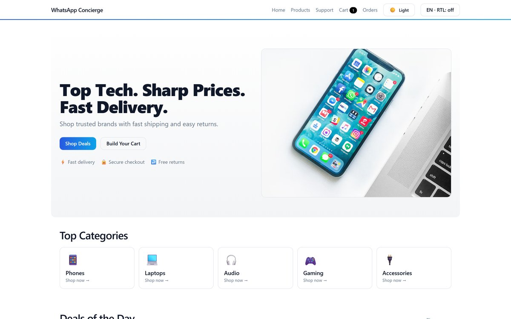
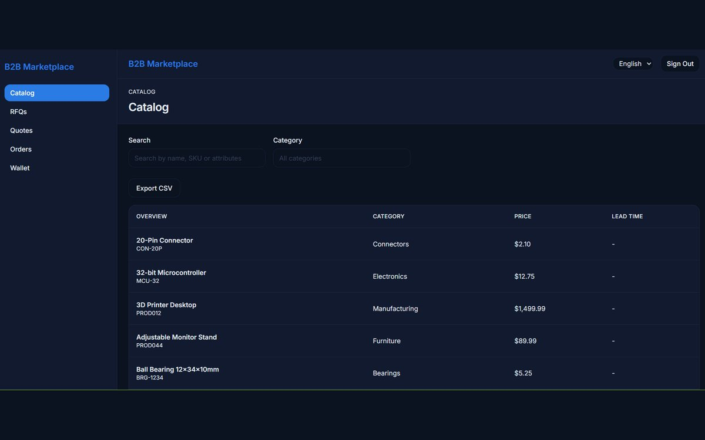
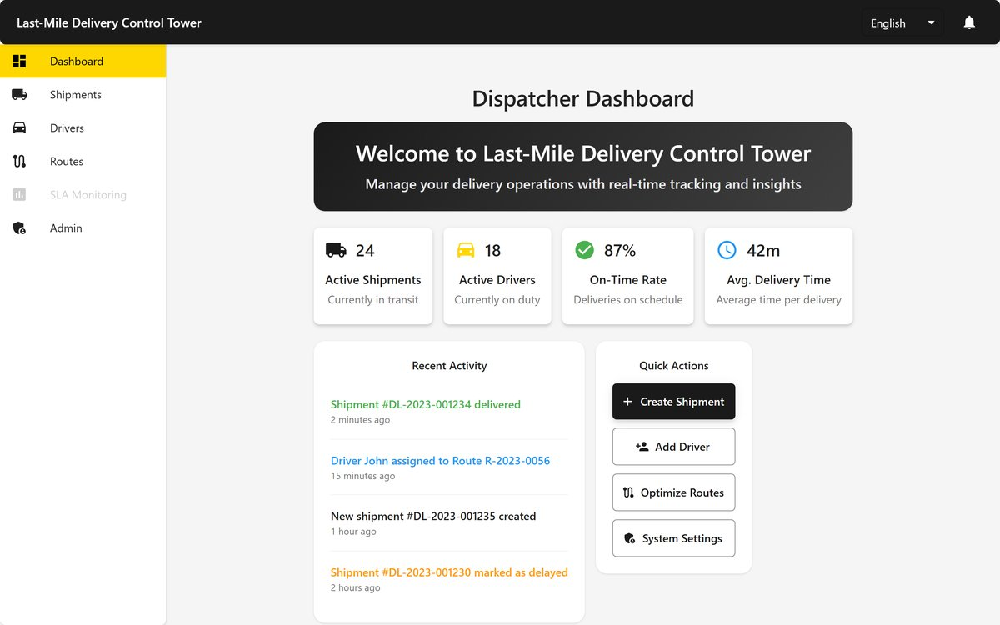
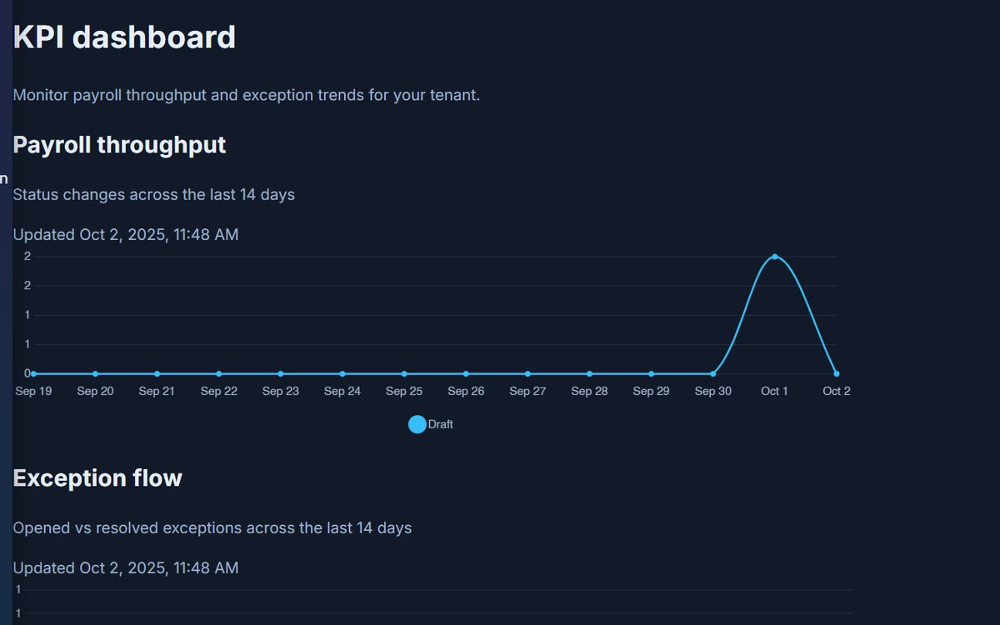

# Ahmed Mahmoud Moustafa

**Technical product manager · Systems engineer · Researcher & teacher**

I’m a technical product manager with a PhD in cyber-physical systems. I’m Interim Head of the Computers and Systems Engineering Department at Minia University, where I’m also an Associate Professor.

I enjoy the part of product work where a choice has to be made: what to build first, what to simplify, and what needs more evidence. That’s where I bring my engineering background, especially when software has to work with people, everyday processes, or physical systems.

**Open to technical product manager roles.**

[LinkedIn](https://www.linkedin.com/in/ahmedmmkms/) · [Research](https://scholar.google.com/citations?hl=en&user=iKZKLygAAAAJ) · [Email](mailto:ahmedmmkms@gmail.com)

## Software projects

Four independent MVPs I defined and built. Each repository opens with a product brief: the problem, the users, key decisions and trade-offs, what I left out, and what a pilot would measure. None has real customers yet.

<table>
  <tr>
    <td width="50%" valign="top">
      
      <h3>WhatsApp Commerce Concierge</h3>
      
Bilingual shopping across WhatsApp and the web, from browsing to orders, returns and support.

      
<a href="https://whatsapp-commerce-concierge-web.vercel.app">Live demo</a> · <a href="https://github.com/ahmedmmkms/whatsapp-commerce-concierge#product-brief">Product brief</a> · <a href="https://github.com/ahmedmmkms/whatsapp-commerce-concierge">Code</a>

      Next.js · NestJS · PostgreSQL · Redis · WhatsApp Cloud API
    </td>
    <td width="50%" valign="top">
      
      <h3>Centralized Procurement Platform</h3>
      
B2B buying in one flow: catalog, requests for quotes, quote comparison, approvals and orders.

      
<a href="https://b2b-marketplace.pages.dev/en">Live demo</a> · <a href="https://github.com/ahmedmmkms/b2b-marketplace#product-brief">Product brief</a> · <a href="https://github.com/ahmedmmkms/b2b-marketplace">Code</a>

      Next.js · Spring Boot · OpenAPI · PostgreSQL
    </td>
  </tr>
  <tr>
    <td width="50%" valign="top">
      
      <h3>Last-Mile Delivery Control Tower</h3>
      
Dispatch, live tracking, proof of delivery, cash-on-delivery reconciliation and SLA monitoring.

      
<a href="https://last-mile-control-tower.vercel.app">Live demo</a> · <a href="https://github.com/ahmedmmkms/last-mile-control-tower#product-brief">Product brief</a> · <a href="https://github.com/ahmedmmkms/last-mile-control-tower">Code</a>

      React · Node.js · PostgreSQL · Socket.IO
    </td>
    <td width="50%" valign="top">
      
      <h3>WPS Payroll Compliance</h3>
      
Multi-tenant payroll validation that catches errors before a file reaches the bank, with tracked exceptions and audit trails.

      
<a href="https://github.com/ahmedmmkms/WPSPayrollCompliance#product-brief">Product brief</a> · <a href="https://github.com/ahmedmmkms/WPSPayrollCompliance">Code</a>

      Laravel · Filament · PostgreSQL · Redis
    </td>
  </tr>
</table>

## Product work at Minia University

Two internal platforms for the Faculty of Engineering. They aren’t public, so there are no links.

- **NEFREX, a governance and excellence platform** (definition and design). I own the product definition for a faculty-wide platform that puts the National Government Excellence Model into practice, linking criteria, KPIs, evidence and approvals. I wrote the vision, a 12-week roadmap and the backlog.
- **QOps, a quality management platform** (in development). One system that turns scattered quality processes into structured tasks, approvals and traceable workflows.

## Concept case studies

Four developed studies of how I work through product decisions. Each has a concrete scenario, alternatives, testable requirements, six proposed screens and a validation plan. The assumptions are explicit; customer interviews, prototypes and pilots are future work.

| Case | The question it works through |
|---|---|
| [**AI Operations Copilot**](https://github.com/ahmedmmkms/ahmedmmkms/blob/main/portfolio/case-studies/ai-operations-copilot.md) | Can an assistant turn incident notes into useful follow-up tasks without making the reviewer’s job harder? |
| [**Clinical Workflow**](https://github.com/ahmedmmkms/ahmedmmkms/blob/main/portfolio/case-studies/clinical-workflow.md) | How do you keep a lab visit traceable from registration to report, including mismatched specimens and corrected records? |
| [**Predictive Maintenance**](https://github.com/ahmedmmkms/ahmedmmkms/blob/main/portfolio/case-studies/predictive-maintenance.md) | How far can useful signals and explainable alerts go before a model predicts failures? |
| [**Safe School Pickup**](https://github.com/ahmedmmkms/ahmedmmkms/blob/main/portfolio/case-studies/safe-school-pickup.md) | How do you make pickup easy to coordinate while a staff member still confirms every handover? |

[**Browse the full catalogue →**](https://github.com/ahmedmmkms/ahmedmmkms/blob/main/portfolio/README.md)

## Writing

I write about the economics of AI products and how AI changes work.

- [From Zero Marginal Cost to Metered Intelligence: The New Economics of AI Software](https://www.linkedin.com/pulse/from-zero-marginal-cost-metered-intelligence-new-ai-software-mahmoud-gff0f/)
- [From Managing People to Managing Agents: The Next Transformation in Project Management](https://www.linkedin.com/pulse/from-managing-people-agents-next-transformation-project-ahmed-mahmoud-aoawe/)
- [The Value Era: Why Product Thinking Isn’t Enough Anymore](https://www.linkedin.com/pulse/value-era-why-product-thinking-isnt-enough-anymore-ahmed-mahmoud-px4wf/)
- [AI Did Not Make Work Simpler. It Made Expectations Heavier.](https://www.linkedin.com/pulse/ai-did-make-work-simpler-made-expectations-heavier-ahmed-mahmoud-gmutf/)

[All articles on LinkedIn →](https://www.linkedin.com/in/ahmedmmkms/recent-activity/articles/)

## The engineering side of me

My research covers wind-energy systems, real-time control, system emulation, and autonomous platforms. That work keeps me interested in what happens beyond the screen: timing, uncertainty, physical constraints, and how a system behaves when conditions change.

You’ll find my papers under **Ahmed Moustafa** and **Ahmed M. Moustafa**.

- **Energy systems:** [wind-energy survey](https://scholar.google.com/citations?view_op=view_citation&hl=en&user=iKZKLygAAAAJ&citation_for_view=iKZKLygAAAAJ:Se3iqnhoufwC) and [hydrogen-storage control](https://doi.org/10.1016/j.ijhydene.2023.08.208).
- **Real-time control:** [wind-turbine emulation and model predictive control](https://scholar.google.com/citations?view_op=view_citation&hl=en&user=iKZKLygAAAAJ&citation_for_view=iKZKLygAAAAJ:5nxA0vEk-isC).
- **Autonomous systems:** [quadrotor control](https://doi.org/10.3390/drones6120379), [lane keeping](https://doi.org/10.1109/ICENCO48310.2019.9027294), and the [TORCS Simulink Client](https://github.com/ahmedmmkms/TORCS_Simulink_Client).

## How I approach a product problem

I start with the work someone is trying to do. Then I look at the constraints, compare a few realistic options, and choose a small enough scope to learn from.

A few questions keep me honest: **What evidence supports this? What are we giving up? What would make us change our minds?**

Teaching and research are part of this picture too. I want the reasoning to be clear enough for someone else to question it, whether it ends up in a classroom, a technical discussion, or a product decision.

[More about my approach](https://github.com/ahmedmmkms/ahmedmmkms/blob/main/portfolio/approach.md) · [Systems thinking in practice](https://github.com/ahmedmmkms/ahmedmmkms/blob/main/portfolio/systems-thinking.md)

## Say hello

If you’re working on a product where the engineering and the day-to-day workflow are tightly connected, I’d be glad to compare notes.

[**Find me on LinkedIn**](https://www.linkedin.com/in/ahmedmmkms/) · [**Send me an email**](mailto:ahmedmmkms@gmail.com)
